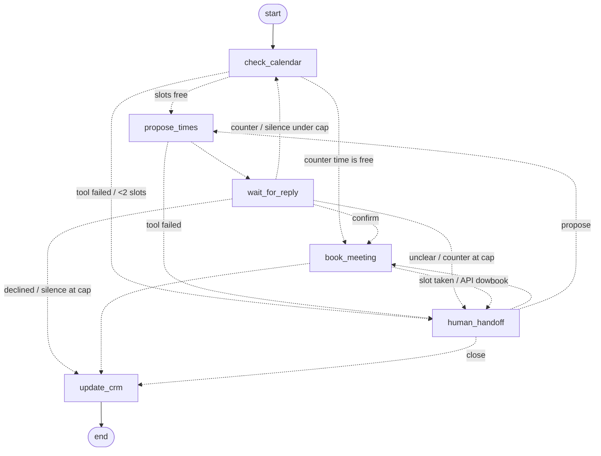

# Sprinto Outreach-to-Meeting Agent

Automates everything **after** a cold email goes out: reading the reply, checking the
calendar, proposing times, handling counter-proposals and silence, booking the meeting,
and writing the result to the CRM. It works out its own next step from the shared state
instead of following a fixed script.

```
ICP gate ──► Sequence 1: Send & Wait (plain Python) ──► interested? ──► Sequence 2: Schedule the Call (LangGraph)
   │                    │ not_interested / no_reply / bounce                    │
   └── disqualified ────┴──────────────────────────► update_crm ◄───────────────┘
```

## Quick start

```bash
python3 -m venv .venv && .venv/bin/pip install -r requirements-dev.txt
```

```bash
.venv/bin/python -m outreach                 # run all 13 scenarios (handoffs decided automatically)
```

```bash
.venv/bin/python -m outreach -s counter_cap_handoff --interactive   # optional: decide the handoff yourself
```

```bash
.venv/bin/python -m pytest -q                # 46 tests
```

### Dashboard

```bash
.venv/bin/python -m outreach.dashboard       # opens http://localhost:8765
```

A local web page that runs the real agent and shows:

* **Runs:** headline numbers (meetings booked, automatic decisions, failures handled) and every
  scenario. For each run: its path through both sequences drawn on the workflow diagram (loops
  marked ×N), the six state fields, each automatic decision and its reason, the event
  timeline, the emails sent, every tool call and retry, and the CRM record.
* **Playground:** pick a prospect, write their replies line by line (`-` = no reply), add busy
  calendar slots, inject transient or permanent failures for any tool, and run the agent.
* **How it decides:** the decision policy, retry table, caps, ICP rules and tool descriptions. Each
  rule lists the runs where it was used.

Everything is tappable and linked:

* **Headline tiles filter the runs.** Tap "Flagged for review" to see only those runs. Tap again to clear.
* **Diagram steps open their details.** Tap "Check calendar" to see every call, retry and log line from that step.
* **Views lead to each other.** A decision links to its rule, a rule links to the runs that used it, a tool call
  links to its retry policy, and any run can be replayed and edited in the Playground.
* **Every view is a shareable link.** The address holds the run, filter, step or rule
  (e.g. `#run=counter_cap_handoff&step=human_handoff`). Playground links include the whole setup, so the
  person you send it to sees the same run. Use "Copy link to this run".
* On phones, tap targets are at least 44px and the rule tables become stacked cards.

It uses only Python's standard library (`outreach/dashboard.py` + `outreach/static/dashboard.html`),
listens on 127.0.0.1 only, and every run uses a fresh in-memory world.

### Deployment (Vercel)

**Live dashboard: https://sprinto-outreach-omega.vercel.app**

Deployed with the Vercel CLI (`npx vercel deploy --prod --scope 22-0b11` from the project folder). To redeploy
automatically on every push, connect this GitHub repo under the Vercel project's Settings → Git. That needs
the Vercel GitHub app on `sanjanapundir-ai` to include this repo. How it is set up:

* `vercel.json`: `"framework": null` (separate functions, not a single Python app); the build copies `outreach/static/dashboard.html` to `public/index.html` (served as the page).
* `api/meta.py`, `api/run.py`, `api/custom.py`: Python serverless functions that reuse
  `outreach.dashboard.Handler`, so local and deployed behaviour are identical.
* `requirements.txt` holds runtime dependencies only (what Vercel installs). `requirements-dev.txt` adds pytest.

Other flags: `--tools` (the tool descriptions the model sees), `--retry-table`, `--mermaid` (graph diagram).

Everything runs offline. Mail, calendar and CRM are in-memory stand-ins (`outreach/world.py`)
with failure injection, so every branch and every row of the retry table can be exercised
deterministically.

## How the build checklist maps to the code

| # | Checklist step | Where |
|---|---|---|
| 1 | ICP parameters: variables, target pages, valid answers, short-circuit rules | `outreach/icp.py`, `data/prospects.json` |
| 2 | Tool descriptions (four golden rules) | `outreach/tools.py` → `TOOL_SPECS` |
| 3 | 6-field state schema | `outreach/state.py` |
| 4 | Edges, loop-backs, human escalation gate | `outreach/sequence2.py` (routers + `add_conditional_edges`) |
| 5 | Retry table + iteration caps | `outreach/retry.py` |
| 6 | LangGraph runner with checkpointing | `outreach/sequence2.py`, `outreach/pipeline.py` |
| – | Automatic handoff decisions | `outreach/decider.py` |
| – | Dashboard | `outreach/dashboard.py`, `outreach/static/dashboard.html` |

## 1. ICP gate

Prospects are the cleaned, structured output of the data-gathering step (APIs and data
providers first, scraping only as a last resort). `qualify()` applies short-circuit rules in
order: missing email, too small, too large, wrong industry, already certified on a
competitor, or wrong role. A disqualified prospect is logged to the CRM and **never emailed**.

## 2. Tools: what the model sees

The model never sees the Python code. It sees the description, every time it runs. Each
description in `TOOL_SPECS` has four sections in this order: **WHAT IT DOES / WHEN TO USE /
WHEN NOT TO USE / RETURNS**. A test enforces this. The specs use the JSON-schema tool format
that the Claude API and LangChain `bind_tools` both accept.

| Tool | Purpose |
|---|---|
| `send_email` | Initial cold email (Sequence 1) |
| `check_calendar` | Are these specific slots free? |
| `propose_times` | `send_email` in propose mode: reply with 2–3 checked slots |
| `book_meeting` | Create the event and send the invite |
| `update_crm` | Write the final outcome, exactly once per run |

## 3. State object

Six fixed fields, defined before the run starts. Every node reads and writes them, and
LangGraph checkpoints them after each step:

| Field | Values |
|---|---|
| `reply_status` | `no_reply` · `interested` · `not_interested` |
| `calendar_checked` | `true` / `false` (reset to `false` when a counter-proposal or silence means we have to check again) |
| `times_proposed` | slots in the most recent proposal |
| `reply_round` | 0 = nothing sent, 1 = first proposal, 2+ = retry or counter |
| `meeting_status` | `unscheduled` · `pending_confirmation` · `confirmed` |
| `crm_logged` | `true` / `false` |

The other fields (prospect, free slots, parsed reply intent, escalation flag, audit `events`)
are payload. Routers only read the core fields plus the intent and escalation flags.

## 4. Sequence 2 graph



* **Loop-backs:** a counter-proposal goes back to `check_calendar`. If the time they asked for
  is free, it is booked directly. If not, the agent offers nearby alternatives it has not
  already offered. Silence triggers a nudge with a fresh set of times, looking further out
  each round.
* **Handoff:** `human_handoff` calls LangGraph `interrupt()`. The run pauses, state is
  checkpointed under `thread_id = prospect id`, and it resumes with a decision:
  `{"action": "book", "slot": ...}`, `{"action": "propose", "slots": [...]}` or
  `{"action": "close"}`. By default `decider.py` makes that decision automatically (see below).
  Pass `human=None` to `run_prospect` to pause for a person instead, then continue with
  `resume_prospect(graph, id, decision)`, or use `--interactive` on the CLI.
* **Sequence 1 is plain Python** (`sequence1.py`). It is one send, one wait and a three-way
  branch, with no loops or memory, so a framework would add nothing.

## Automatic handoff decisions

The decider reads the paused run's details (escalation kind, requested or lost slot, round,
times proposed, last reply) and applies a fixed policy. Every decision and its reason is
written to the audit trail, and any slot it books or proposes is checked with
`check_calendar` first.

| Escalation | Automatic decision |
|---|---|
| `counter_cap` (3 rounds used) | Book the requested time if it's free, otherwise the closest free slot at the prospect's preferred time of day. The invite lets them accept or move it. |
| `booking_failed` (slot taken) | Book the closest free slot at the same time of day. |
| `unclear_reply` | Under the round cap: propose fresh checked slots. At the cap: close as `needs_review`. |
| `calendar_failed` | Close as `needs_review`, because it never books a slot it couldn't check. |
| `propose_failed` / `no_free_slots` | Close as `needs_review`. |

## 5. Retry table

| Tool | Retries (transient) | Retries used up | Permanent failure | Does anything downstream depend on it? |
|---|---|---|---|---|
| `send_email` | 2 | abort | abort (bounce) | Yes: the whole sequence starts here |
| `check_calendar` | 3 | escalate | escalate | Yes: never propose or book unchecked slots |
| `propose_times` | 2 | escalate | escalate | Yes: the prospect is waiting for times |
| `book_meeting` | 3 | escalate | escalate (slot taken) | Yes: a confirmed prospect needs an invite |
| `update_crm` | 3 | skip → dead-letter | skip → dead-letter | No: it is the last step |

Transient failures are retried with exponential backoff. Permanent failures are never retried.
Hard caps: `MAX_REPLY_ROUNDS = 3` proposals per prospect and a LangGraph `recursion_limit` of 40.

## Scenarios (`python -m outreach`)

| Scenario | What it exercises | Outcome |
|---|---|---|
| happy_path | interested → Option 2 | meeting_booked |
| counter_busy | counter at a busy time → alternatives → accept | meeting_booked |
| counter_free | counter at a free time → booked directly | meeting_booked |
| silence_after_interest | 3 unanswered proposals (cap) | no_response |
| not_interested | Sequence 1 only | not_interested |
| no_reply_and_crm_down | CRM fails 4× → skip to dead-letter | no_reply |
| bounce | permanent failure, 1 attempt, abort | bounced |
| counter_cap_handoff | counter limit hit → auto-books Mon 15:00 (asked Sun 15:00) | meeting_booked |
| flaky_calendar | 2 timeouts, then success | meeting_booked |
| calendar_down_handoff | retries used up → escalate → auto-closes | needs_review |
| booking_conflict | slot taken → auto-books same time next day | meeting_booked |
| disqualified_small / _competitor | ICP short-circuit | disqualified |

## Going to production

* **Real systems:** replace the `World` methods with Gmail, Google Calendar and HubSpot
  adapters (or their MCP servers, which bring their own tool descriptions). Only
  `tools.py` talks to `World`.
* **Real waiting:** make `wait_for_reply` call `interrupt()` and resume it from an inbox webhook.
  Swap `MemorySaver` for a durable checkpointer (`langgraph-checkpoint-sqlite` or
  `-postgres`) so paused runs survive restarts.
* **LLM steps:** `classify.py` is rule-based so tests stay deterministic. Replace its bodies with
  an LLM call constrained to the same labels, and pass `TOOL_SPECS` to the model if you want it
  to pick tools itself.
